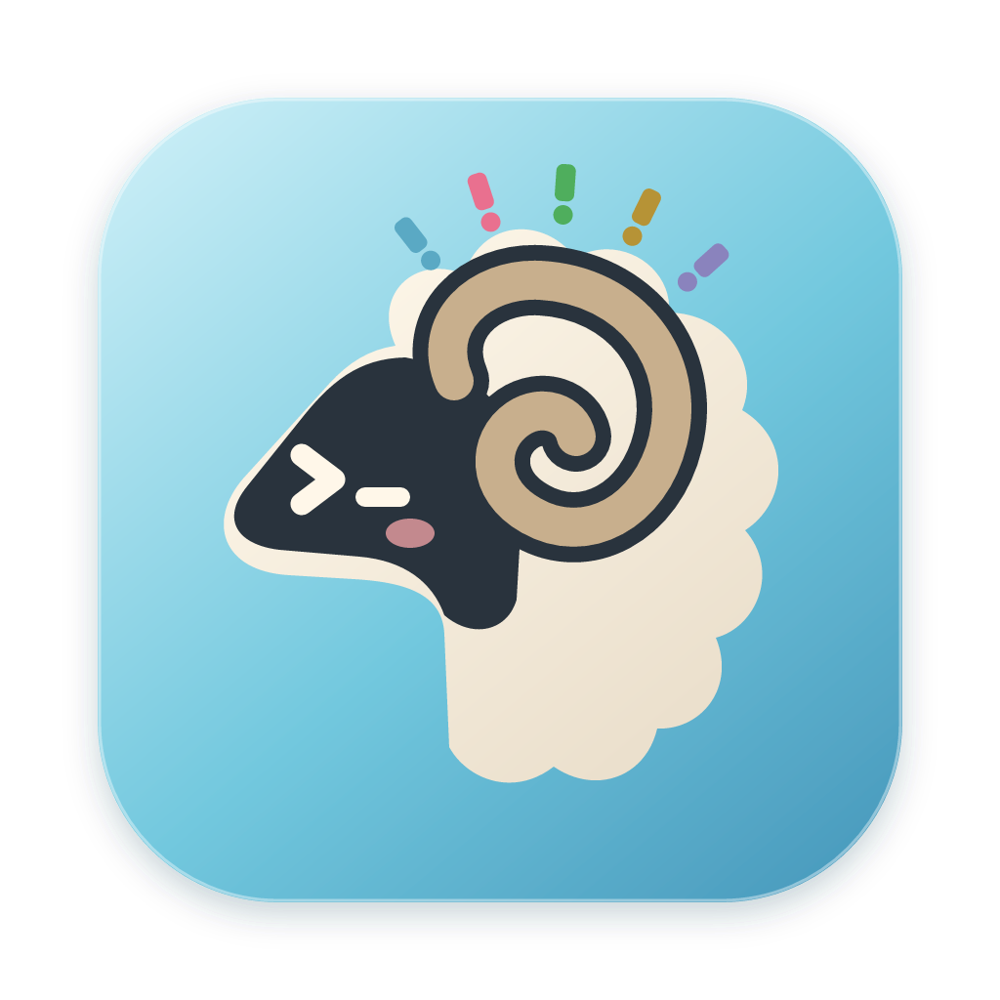

# Hergo

<p align="center">
  
</p>

<p align="center">
  Herdr 的原生桌面客户端，让工作区、Git 工作树、AI 编程助手和多窗格终端集中在一个窗口里。
</p>

<p align="center">
  <a href="https://github.com/Maidang1/hergo/releases/latest">下载最新版本</a> ·
  <a href="CHANGELOG.md">更新记录</a> ·
  <a href="https://github.com/Maidang1/hergo/issues">反馈问题</a>
</p>

Hergo 取名自 **Her**dr 与 my**go**，使用 Go 和 [mygo](https://github.com/egoist/mygo) 构建。支持 macOS、Windows 和 Linux，界面与终端均为原生渲染，无需 WebView 或 Node.js 运行时。

## 可以做什么

- **管理工作区**：浏览 [Herdr](https://github.com/herdrdev/herdr) 会话、工作区与 Git 工作树，查看分支、领先与落后提交数和本地监听端口。
- **使用多窗格终端**：新建与切换标签，水平或垂直分屏，调整比例、方向聚焦、放大窗格，并保存和恢复标签布局。
- **查看代码改动**：浏览未提交改动和最近 100 条提交，使用单栏或左右对照 diff、语法高亮、搜索及手动刷新。
- **跟进 AI 编程助手**：按工作区查看 agent 状态与详情，发送 prompt、启动 agent，以及设置停止提醒或输出匹配提醒。
- **整理会话**：拖拽排序工作区与标签，将窗格移到其他标签或工作区，筛选全部、需要处理或工作中的 agent。
- **调整终端外观**：设置字体、光标与键盘行为，跟随 Herdr 配色，或选择 Hergo 及 Monokai Pro 亮暗主题。
- **使用本地终端**：通过纯净终端模式打开本地 shell 与标签，也可以将它设为默认启动方式。
- **管理 Herdr**：安装或选择 Herdr，管理插件、会话恢复配置与 SSH 机器，并检查应用更新。

## 安装

从 [GitHub Releases](https://github.com/Maidang1/hergo/releases/latest) 下载对应平台的安装包。建议使用同一 release 提供的 SHA-256 文件校验下载内容。

| 平台 | 安装包 | 环境 |
| --- | --- | --- |
| macOS | 通用 `.dmg` | 同时支持 Apple Silicon 与 Intel |
| Windows x64 | `-setup.exe` 或便携 `.zip` | 原生 Windows 桌面 |
| Linux amd64 / arm64 | `.deb` 或便携 `.tar.gz` + `install.sh` | Ubuntu 22.04+ 为验证基线，需要 glibc、GTK 3 和图形会话 |

### macOS

打开 DMG，将 **Hergo.app** 拖入 Applications。

当前应用使用 ad hoc 签名，未经 Apple 公证。首次启动被 Gatekeeper 阻止时，确认安装包来源后执行：

```sh
xattr -dr com.apple.quarantine "/Applications/Hergo.app"
```

### Windows

运行安装器，或完整解压便携 ZIP 后启动应用。请保留解压目录中的资源文件。

安装、原生终端支持与构建说明见 [Windows 支持文档](docs/windows-support.md)。

### Linux

`amd64` 对应 x86_64，`arm64` 对应 aarch64。

- **Debian / Ubuntu**：执行 `sudo apt install ./hergo_<version>_<arch>.deb`，安装后运行 `hergo`。
- **用户级安装**：下载同一 release 的 `install.sh` 和便携归档，以普通用户执行 `sh install.sh ./hergo-<version>-linux-<arch>.tar.gz`。
- **便携运行**：完整解压归档，运行其中的 `./hergo`，并保留所有资源和动态库。

用户级安装需要将 `~/.local/bin` 加入 PATH，支持应用内更新。系统级 `.deb` 安装请使用新版 `.deb` 更新，不要以 root 运行 GUI。

GTK 依赖、完整命令和平台限制见 [Linux 支持文档](docs/linux-support.md)。

## 第一次启动

Hergo 使用本机安装的 Herdr，不捆绑 Herdr 可执行文件。启动时会在 PATH 和常见安装目录中查找 `herdr`；从 macOS Dock 或 Finder 打开时，也会补上登录 shell 的 PATH。

| 本机状态 | 启动行为 |
| --- | --- |
| Herdr 已安装，默认会话正在运行 | 直接连接，显示工作区与终端 |
| Herdr 已安装，默认会话尚未运行 | 启动 `herdr server`，等待连接后进入 |
| Herdr 未安装 | 显示安装页，可安装官方版本、选择已有可执行文件或打开纯净终端 |

**Install Herdr** 使用官方安装脚本：[Unix](https://herdr.dev/install.sh) / [Windows](https://herdr.dev/install.ps1)。Windows 和 Linux 的 CI 集成测试使用 Herdr 0.9.5，实际可用 API 取决于本机运行的 Herdr 版本。

在 **Settings → Herdr → Startup** 中选择默认启动方式：

- **Automatic / Herdr**：进入 Herdr 工作区；未安装时显示安装页。
- **Plain terminal**：打开本地 shell，不连接 Herdr。

命令行 `-plain` 或 `-connect` 可覆盖本次启动方式。指定 `-socket`、`HERDR_SOCKET_PATH` 或具名 `HERDR_SESSION` 时，只连接指定会话，不启动服务。

关闭 Hergo 不会停止 Herdr 服务或关闭会话。终端已有 owner 时，应用提供诊断信息和 Retry，不会自动接管。

## 日常使用

### 工作区与终端

选择工作区和标签，即可查看标签中的可见终端。使用菜单、右键菜单或命令面板管理标签、分屏和布局。

Herdr 默认 prefix 为 `Ctrl+B`，再按动作键；prefix 后按 `?` 查看快捷键参考。自定义绑定与平台差异见 [快捷键说明](docs/keyboard-parity.md)。

常用 macOS 快捷键：

| 操作 | 快捷键 |
| --- | --- |
| 命令与会话导航 | `Cmd+P` |
| 新建 / 关闭标签 | `Cmd+T` / `Cmd+W` |
| 垂直 / 水平分屏 | `Cmd+D` / `Cmd+Shift+D` |
| 查找终端文字 | `Cmd+F` |
| 显示 / 隐藏侧栏 | `Cmd+B` |
| 跳到等待中的 agent | `Cmd+J` |
| 设置 | `Cmd+,` |
| 放大 / 缩小 / 重置字号 | `Cmd+=` / `Cmd+-` / `Cmd+0` |
| 行首 / 行尾 / 删到行首 | `Cmd+←` / `Cmd+→` / `Cmd+⌫` |
| 按词左移 / 右移 | `Option+←` / `Option+→` |

纯净终端还支持 `Cmd+Shift+[ / ]` 和 `Cmd+1…9` 切换标签；其他平台使用对应的 `Ctrl+Shift` 组合键，并支持 `Ctrl+Tab`。单独的 Ctrl 组合键交给 shell。

### 查看代码改动

在 Git 工作区点击工具栏的 Git 图标，或选择 **View → Show Changes**。不是 Git 仓库时隐藏该入口。

左侧显示未提交改动、最近 100 条提交与文件列表，右侧连续展示文件 diff。选择历史提交可查看它相对第一个父提交的改动；**Unified / Split** 切换单栏与左右对照，**Refresh** 重新读取改动。

已暂存和未暂存改动合并显示，未跟踪文件按新增内容预览。视图状态按工作区保留，关闭 Changes 后终端会话继续运行。该视图只读；二进制、非 UTF-8 或大文件会显示提示或有界 patch。

### Agent 与提醒

在侧栏查看 agent 状态，通过 **Pane → Agent and Process Details** 查看详情，通过 **Pane → Notify When Output Matches** 设置一次输出提醒。

输出提醒检查最近 80 行，已有匹配会立即触发；Details 中可选 Rust 正则及 1–1440 分钟超时，默认 30 分钟。提醒可取消，连接或终端身份变化时结束，不自动重复。

### 配色

默认跟随 Herdr 的 `config.toml`，自动同步窗口和终端的默认背景、文字与选区。修改配置后会自动应用；暂时无法读取或解析时保留当前配色。

要单独设置 Hergo，在 **Settings → Appearance** 关闭 **Follow Herdr**，再选择 System、Hergo Light、Hergo Dark、Herdr 内置主题、Monokai Pro 或 Monokai Pro Light。

跟随 Herdr 时支持亮暗自动切换及自定义覆盖，例如：

```toml
[theme]
name = "gruvbox"
auto_switch = true
dark_name = "gruvbox"
light_name = "gruvbox-light"
```

跟随配置中的 `monokai-pro` 或 `monokai-pro-light` 配合 `auto_switch = true` 时，Hergo 会按系统外观切换这两个本地主题。Herdr 本身是否支持这些名称取决于其版本。配色来源与授权见 [主题说明](internal/design/herdr-ATTRIBUTION.md)。

### 更新与偏好

正式打包且安装位置可写的应用在启动 10 秒后检查更新，此后每天检查一次。也可使用 **Check for Updates** 菜单，或在 **Settings → Updates** 中设置自动检查与安装。下载的更新经过 Ed25519 签名校验。

偏好保存在系统配置目录下的 `hergo/prefs.json`。新文件不存在时会读取旧版偏好，后续修改写入新路径。当前应用标识为 `dev.hergo`，启动命令为 `hergo`；跨名称更新仍需各平台实机验证。`v0.0.6` 及更早版本需要手动安装一次新版才能使用应用内更新。

## 从源码开发

需要 `go.mod` 指定的 Go 版本、Python 3.10+，以及当前平台的原生窗口环境。普通构建无需 npm。

```sh
git clone https://github.com/Maidang1/hergo.git
cd hergo
make test
make run
```

请使用 `make` 或 `scripts/go.sh`。包装脚本会为固定版本的 mygo 生成带必要终端补丁的工作区，不修改 Go module cache。Windows 使用 `python scripts/go.py`，详见平台文档。

| 命令 | 用途 |
| --- | --- |
| `make test` | Python 发布契约测试、Go 测试和 vet |
| `make build` | 构建 `bin/hergo` 和协议探针 |
| `make run` | 构建并打开 Hergo |
| `make probe` | 只读检查 Herdr、配置与布局 |
| `make window` | 打开本地 `/bin/cat` 测试窗口，不连接 Herdr |
| `make integration` | 使用隔离服务验证终端插件与原生窗口 |
| `make package` | 打包当前架构的 macOS `.app` |
| `make dmg` | 打包 macOS 通用 `.app` 与 `.dmg` |
| `make linux` | 打包 Linux 双架构 `.deb`、便携归档与安装脚本 |

macOS 测试若遇到 Unix socket 路径过长，可使用 `TMPDIR=/tmp make test`。

指定 Herdr 可执行文件或会话：

```sh
./bin/hergo -herdr /path/to/herdr
./bin/hergo -socket /path/to/herdr.sock
./bin/hergo -plain
```

默认启动可能启动本机 Herdr 服务。集成测试传入显式 socket，使用独立临时服务，不关闭用户已有会话。开发期首次启动终端可能下载经过校验的原生库，正式安装包已包含动态库。

### 图标资源

应用图标将 Herdr 的公羊、卷角与终端提示符，以及 mygo 的五色感叹号组合成小羊造型。源文件为 [icon.svg](assets/app/icon.svg)，README 与安装包使用 [icon.png](assets/app/icon.png)。设计来源见 [图标说明](assets/app/ICON-NOTICE.md)。

修改应用图标后生成 PNG：

```sh
resvg -w 1024 -h 1024 assets/app/icon.svg assets/app/icon.png
```

重新生成界面使用的嵌入图标：

```sh
npm ci
npm run icons
```

图标来源清单位于 `scripts/icons.json` 与 `internal/icons/SOURCES.txt`。

## 发布

1. 更新 `mygo.json` 的 `version`，在 `CHANGELOG.md` 添加对应说明。
2. 运行 `make test` 并提交。
3. 推送与版本一致的 `vX.Y.Z` 标签。

[Release 工作流](.github/workflows/release.yml)会并行测试和打包 macOS、Windows 与 Linux 双架构，所有平台成功后统一创建 GitHub Release。手动触发只生成工作流产物，不发布 release。

应用更新签名使用 Actions secret `MYGO_UPDATER_PRIVATE_KEY`，仓库配置仅保存公钥。缺少密钥或签名产物会停止发布。

## 文档与已知限制

- [设计与实现](docs/implementation.md)、[功能对齐](docs/feature-parity-plan.md)、[快捷键说明](docs/keyboard-parity.md)。
- [Windows 支持](docs/windows-support.md)、[Linux 支持](docs/linux-support.md)、[API schema](reference/herdr-api-schema.json)。
- [侧栏验证](docs/sidebar-validation.md)及 [M0](docs/m0-validation.md)、[M1](docs/m1-validation.md)、[M2](docs/m2-validation.md)、[M3](docs/m3-validation.md)、[M4](docs/m4-validation.md) 验收记录。
- [Pencil 设计稿](docs.pen/new.pen)；`docs.pen/01.pen` 为历史素材。

Windows IME、AltGr、DPI，Linux X11/Wayland 与 IME，以及 macOS 系统 IME、真实鼠标和 VoiceOver 等仍需实机验收。Windows 终端通过原生 endpoint 渲染，不支持内联图像。

SSH 机器入口使用 Herdr 交互式客户端，不会将远程工作区投射进原生侧栏；远程连接与 Windows 命令终端尚未实机验证。会话恢复设置会修改 Herdr 的 `config.toml`，仅在下次启动 Herdr 时生效；开启终端历史保存时，请留意其中可能包含的敏感内容。

## 许可证与致谢

项目代码采用 [MIT License](LICENSE)。感谢 [Herdr](https://github.com/herdrdev/herdr)、[mygo](https://github.com/egoist/mygo) 及相关开源项目。

第三方代码、图标和品牌标识保留各自的许可证与权利声明：

- [Herdr 配色与 Monokai Pro 主题来源](internal/design/herdr-ATTRIBUTION.md)
- [Monokai Pro MIT 许可证](internal/design/monokai-pro-LICENSE)
- [应用图标说明](assets/app/ICON-NOTICE.md)与[设计图标授权](assets/icons/NOTICE.md)
- [Lucide 图标许可证](internal/icons/LICENSE-lucide)
- [Lobe 图标许可证](internal/icons/LICENSE-lobe)
